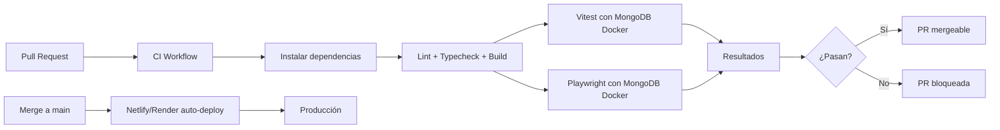

# Plan CI/CD

# Plan de CI/CD para Vegazetas

## Contexto

Tras completar la refactorización (sprints 1–8), Vegazetas necesita un pipeline de CI/CD para automatizar las comprobaciones de calidad en cada Pull Request y proteger la rama `main`. Actualmente todas las comprobaciones se ejecutan localmente.

**Estado actual:**
- Frontend desplegado en Netlify (`https://vegazetas.netlify.app`)
- API desplegada en Render (`https://vegazetas.onrender.com`)
- MongoDB Atlas (clúster gratuito)
- Sin CI/CD configurado — no existen workflows de GitHub Actions
- Despliegue actual: Netlify y Render con deploy automático desde `main`

**Paquetes y scripts disponibles:**
| Paquete | Scripts | Descripción |
|---------|---------|-------------|
| `api/` | `test`, `typecheck` | Express 5, TypeScript, Vitest (424 pruebas) |
| `app/` | `build`, `lint`, `test:e2e` | React 19, Vite 8, Playwright (68 pruebas) |
| `com/` | — | Zod 4, TypeScript (sin scripts propios) |

---

## Decisiones acordadas

| Decisión | Elección | Razonamiento |
|----------|----------|-------------|
| Comprobaciones en PR | Completas | Lint, typecheck, build, Vitest y Playwright en cada PR para máxima protección |
| Despliegue | Manual | Se mantiene el deploy automático existente de Netlify/Render desde `main`. El CI/CD solo hace comprobaciones de calidad |
| Hooks locales | Husky ligero | Pre-commit ejecuta lint + typecheck para evitar commitear código roto |
| MongoDB en CI | Docker Service | Aislado y desechable, igual que en desarrollo local. Sin coste adicional |

---

## Arquitectura del pipeline



### Flujo de Pull Request

1. **Instalación reproducible:** `npm ci` en `com`, `api` y `app` (usa lockfile)
2. **Comprobaciones estáticas:**
   - `api/typecheck` — `tsc --noEmit` en la API
   - `app/lint` — ESLint en el frontend
   - `app/typecheck` — `tsc --noEmit` en el frontend (vía `npm run build` que incluye typecheck)
   - `app/build` — `vite build` para verificar compilación
3. **Pruebas de API (Vitest):** Arranca MongoDB 8 como Docker service, ejecuta `api/test` con `SPEC_MONGO_URL` apuntando al servicio
4. **Pruebas E2E (Playwright):** Arranca MongoDB 8 como Docker service, ejecuta `app/test:e2e` con `E2E_MONGO_URL` apuntando al servicio
5. **Resultados:** Todas las comprobaciones deben pasar para que la PR sea mergeable

### Flujo de Merge a main

El merge a `main` dispara el deploy automático existente de Netlify y Render. No se añade workflow de despliegue en CI/CD — se mantiene el flujo actual.

---

## Workflows de GitHub Actions

### 1. `ci.yml` — Comprobaciones en Pull Request

**Trigger:** `pull_request` hacia `main` (y `dev` si existe)

**Jobs:**

| Job | Runner | Pasos | Tiempo estimado |
|-----|--------|-------|----------------|
| `install` | ubuntu-latest | `npm ci` en com, api, app | ~1 min |
| `lint` | ubuntu-latest | `app/lint` (depende de install) | ~1 min |
| `typecheck` | ubuntu-latest | `api/typecheck` + `app/typecheck` (depende de install) | ~1 min |
| `build` | ubuntu-latest | `app/build` (depende de install) | ~2 min |
| `vitest` | ubuntu-latest | MongoDB service + `api/test` (depende de install) | ~4 min |
| `playwright` | ubuntu-latest | MongoDB service + `app/test:e2e` (depende de install) | ~6 min |

**MongoDB Docker Service:**
``yaml
services:
  mongodb:
    image: mongo:8
    ports:
      - 27017:27017
    options: >-
      --health-interval=10s
      --health-timeout=5s
      --health-retries=5
      --health-cmd="mongosh --eval 'db.adminCommand("ping")'"
```

**Variables de entorno:**
- `SPEC_MONGO_URL=mongodb://127.0.0.1:27017/vegazetas_spec_disposable`
- `E2E_MONGO_URL=mongodb://127.0.0.1:27017/vegazetas_e2e_disposable`
- `JWT_SECRET=ci-test-secret`

**Tiempo total estimado:** ~10-12 minutos (jobs paralelos después de install)

### 2. `husky-setup` — No necesario

Husky se configura localmente en el repositorio, no requiere workflow.

---

## Husky — Hooks locales

### Configuración

| Archivo | Acción |
|---------|--------|
| Raíz: `package.json` | Añadir scripts y devDependencies |
| Raíz: `.husky/pre-commit` | Hook que ejecuta comprobaciones rápidas |

### Hook pre-commit

Ejecuta las comprobaciones rápidas antes de cada commit:

1. **Lint del frontend:** `cd app && npm run lint`
2. **Typecheck de la API:** `cd api && npm run typecheck`
3. **Typecheck del frontend:** `cd app && npx tsc --noEmit`

No ejecuta pruebas ni build completo para mantener el commit rápido (~1-2 min).

### Instalación

```
npm install --save-dev husky
npx husky init
```

El hook se añade a `.gitignore` excepto la configuración básica, para que cada desarrollador lo instale con `npm install`.

---

## Archivos a crear/modificar

### Crear

| Archivo | Descripción |
|---------|-------------|
| `.github/workflows/ci.yml` | Workflow principal de CI con jobs paralelos |
| `package.json` (raíz) | Scripts para Husky y devDependencies |
| `.husky/pre-commit` | Hook de pre-commit con lint + typecheck |

### Modificar

| Archivo | Cambio |
|---------|--------|
| `doc/PLAN-REFACTORIZACION.md` | Se elimina (reemplazado por este plan) |
| `doc/ESTADO-ACTUAL.md` | Se actualiza la sección de CI/CD para reflejar el pipeline activo |
| `README.md` y `README-EN.md` | Se añade badge del pipeline de CI |

---

## Coste estimado

| Recurso | Coste |
|---------|-------|
| GitHub Actions (repo público) | Gratis — minutos ilimitados |
| GitHub Actions (repo privado, Free) | 2,000 min/mes incluidos — ~130-150 PRs/mes |
| MongoDB Docker Service | Incluido en minutos del runner |
| Storage de artifacts | 500 MB incluidos (no se usan artifacts) |

**Total:** Gratis para repos públicos. Para repos privados, cabe dentro de los 2,000 minutos gratuitos con un volumen normal de PRs.

---

## Riesgos y mitigación

| Riesgo | Impacto | Mitigación |
|--------|---------|------------|
| Playwright lento en CI (~6 min) | PRs tardan más | Se puede mover a un workflow separado si el tiempo es problema |
| MongoDB Docker Service falla | Pruebas fallan sin causa real | Health check con retries en la configuración del servicio |
| Minutos de CI agotados (repo privado) | Jobs fallan | Monitorizar uso en Settings → Actions. Con ~130 PRs/mes es suficiente |
| Secretos en CI | Seguridad | Solo se usan valores de prueba (JWT_SECRET ficticio). No se almacenan secretos reales |

---

## Validación

Tras implementar el pipeline:

1. Crear una rama de prueba y abrir una PR hacia `main`
2. Verificar que todos los jobs se ejecutan y pasan
3. Verificar que el hook pre-commit funciona localmente
4. Verificar que el merge a `main` dispara el deploy de Netlify/Render como antes
5. Cerrar la PR y eliminar la rama de prueba

---

## Fases de implementación

### Fase 1: Workflow de CI

Crear `.github/workflows/ci.yml` con jobs paralelos para lint, typecheck, build, Vitest y Playwright. Configurar MongoDB como Docker service con las variables de entorno necesarias.

### Fase 2: Husky — Hooks locales

Añadir Husky en la raíz con hook pre-commit que ejecuta lint y typecheck. Configurar `package.json` de la raíz con los scripts necesarios.

### Fase 3: Documentación y limpieza

Actualizar `doc/ESTADO-ACTUAL.md` para reflejar el CI/CD activo, añadir badges de CI en los README y eliminar `doc/PLAN-REFACTORIZACION.md`.

### Fase 4: Validación

Crear una PR de prueba para verificar el pipeline completo, validar el hook pre-commit localmente y confirmar que el despliegue existente no se ve afectado.

# Delivery Steps

###   Step 1: Crear workflow de CI con GitHub Actions
Se crea `.github/workflows/ci.yml` con jobs paralelos para todas las comprobaciones.

- Job `install`: `npm ci` en `com`, `api` y `app` usando lockfile para instalación reproducible.
- Job `lint`: ejecuta `npm run lint` en `app/` (ESLint).
- Job `typecheck`: ejecuta `npm run typecheck` en `api/` y `npx tsc --noEmit` en `app/`.
- Job `build`: ejecuta `npm run build` en `app/` (Vite).
- Job `vitest`: arranca MongoDB 8 como Docker service, configura `SPEC_MONGO_URL` y `JWT_SECRET`, ejecuta `npm test` en `api/`.
- Job `playwright`: arranca MongoDB 8 como Docker service, configura `E2E_MONGO_URL` y `JWT_SECRET`, ejecuta `npm run test:e2e` en `app/`.
- Los jobs de lint, typecheck, build, vitest y playwright dependen de `install` y se ejecutan en paralelo.
- MongoDB service con health check: `mongo:8` image, puerto 27017, con retries y health-cmd.

###   Step 2: Configurar Husky con hook pre-commit
Se añade Husky en la raíz del proyecto para ejecutar comprobaciones rápidas antes de cada commit.

- Crear `package.json` en la raíz con `devDependencies: { husky }` y scripts para inicializar Husky.
- Crear `.husky/pre-commit` que ejecuta: `cd app && npm run lint`, `cd api && npm run typecheck`, `cd app && npx tsc --noEmit`.
- El hook no ejecuta pruebas ni build completo para mantener el commit rápido (~1-2 min).
- Añadir `.husky/` al `.gitignore` solo para la configuración generada, manteniendo el script pre-commit versionado.

###   Step 3: Actualizar documentación y eliminar plan de refactorización
Se actualiza la documentación para reflejar el CI/CD activo y se elimina el plan de refactorización.

- Actualizar `doc/ESTADO-ACTUAL.md`: sección de CI/CD con el pipeline activo, MongoDB Docker Service, y Husky.
- Añadir badge de CI en `README.md` y `README-EN.md` (enlazando al workflow de GitHub Actions).
- Eliminar `doc/PLAN-REFACTORIZACION.md` — reemplazado por `doc/next-features/PLAN-CICD.md`.
- Actualizar `doc/HISTORIAL-VERSIONES.md` si se considera un cambio de versión (v2.0.1 o v2.1.0 según la naturaleza del cambio).