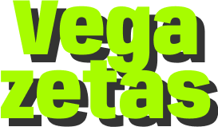

<p align="center">
  
</p>

<h1 align="center">Vegazetas</h1>

<p align="center"><a href="./README.md">Español</a> · English</p>

<p align="center">
  <strong>A colourful place to create, organise and share vegan recipes.</strong>
  <br>
  Designed and handcrafted entirely by me, from Figma to deployment.
</p>

<p align="center">
  <a href="https://vegazetas.netlify.app/">Explore Vegazetas</a>
</p>

<p align="center">
  <a href="https://github.com/Yevestevez">GitHub</a> ·
  <a href="https://www.linkedin.com/in/edu-yeves/">LinkedIn</a>
</p>

---

**Reference version: v1.0.0**, corresponding to the current production baseline. No Git tag or release has been created yet.

## About

Vegazetas is a web app for keeping your own vegan recipes and discovering those published by the community. Its expressive, cheerful interface is designed to make creating and browsing recipes feel simple.

I designed and built the entire full-stack project myself: from UX/UI in Figma and the single-page application to the REST API, database and deployment. The project also includes automated tests for the API's business logic.

## Features

- Sign-up, login, logout and password recovery.
- Create, edit and delete recipes.
- Add descriptions, cooking times, difficulty levels, tags, images, ingredients and steps to vegan recipes.
- Edit and reorder preparation steps.
- Publish recipes for others to discover.
- Browse personal recipes and published recipes, and save favourites.

## Tech stack

| Area | Technologies |
| --- | --- |
| Frontend | React, React Router, Tailwind CSS, Vite |
| Backend | Node.js, Express |
| Data | MongoDB, Mongoose |
| Quality | Mocha, Chai, c8, ESLint |

## Structure and data

- [`app/`](./app/): React interface; see its [README](./app/README.md).
- [`api/`](./api/): Express API and MongoDB access; see its [README](./api/README.md).
- [`com/`](./com/): shared validation and errors.
- [`doc/`](./doc/): technical documentation and images.

The model includes users with favourites and recipes with an author, images, description, time, difficulty, tags, ingredients, steps and publication status. Ingredients and steps are embedded in recipes. See the [current-state documentation](./doc/ESTADO-ACTUAL.md) for details.

## Getting started

You will need Node.js, npm and a MongoDB instance. Run the app and API separately.

1. Configure environment variables:
   - In `api/.env`, set `MONGO_URL`, `PORT` and `JWT_SECRET`. Password recovery also requires `FRONTEND_URL`, `MAIL_FROM` and `NODE_ENV=development` in development; production requires `RESEND_API_KEY`.
   - In `app/.env`, set `VITE_API_URL` to the API URL.
2. Install and start the API in one terminal:

   ```bash
   cd api
   npm install
   npm start
   ```

3. Install and start the app in another terminal:

   ```bash
   cd app
   npm install
   npm run dev
   ```

### Tests and quality

The API includes automated tests for its business logic, written with Mocha and Chai. Run them from `api/`:

```bash
npm test
```

Before running the tests, set `SPEC_MONGO_URL` to an **isolated, disposable** MongoDB database: the tests delete users and recipes.

From `app/`, run the linter and create a production build:

```bash
npm run lint
npm run build
```

See the [current-state documentation](./doc/ESTADO-ACTUAL.md) for the technical inventory, variables and known limitations, and the [refactoring plan](./doc/PLAN-REFACTORIZACION.md) for the planned evolution. Both are currently in Spanish.

The [historical coverage screenshot](./doc/images/vegazetas-test-coverage-082025.jpg) is from August 2025 and does not necessarily reflect current coverage.

## Project direction

The project is preparing a more maintainable, secure and accessible foundation for future growth. See the [refactoring plan](./doc/PLAN-REFACTORIZACION.md) for details.

Once that foundation is established, ideas to consider include filters, recipe sharing, lists, profile management, menu planning, cooking mode and display adjustments. These are ideas, not committed features.

## Design

Explore the [Vegazetas Figma prototype](https://www.figma.com/proto/wJ7OQyaNcJneXTPpf4jx6X/Vegazetas?node-id=149-214&t=m7ZNRd48c95egXOo-1&scaling=scale-down&content-scaling=fixed&page-id=149%3A212&starting-point-node-id=149%3A214).
