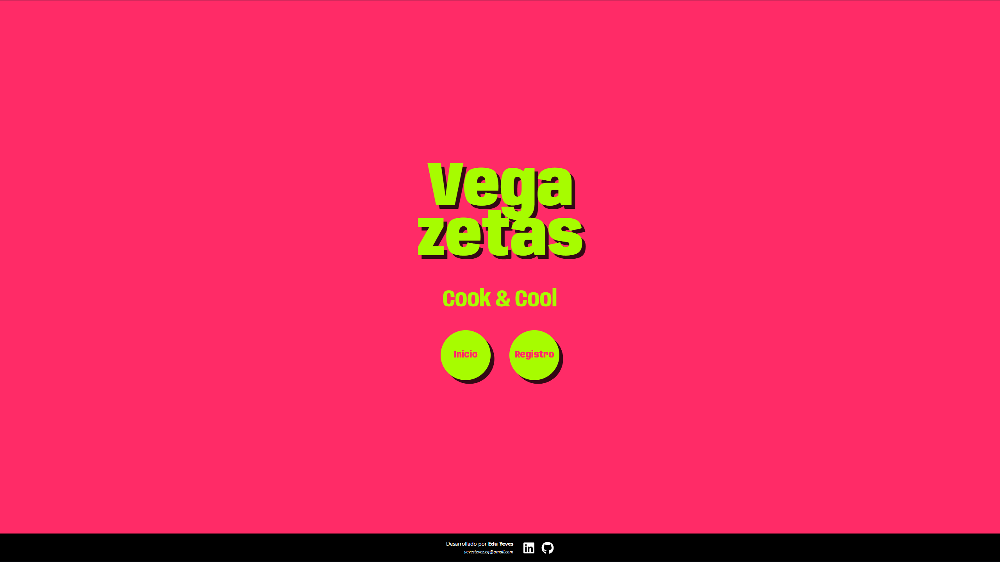

<p align="center">
  
</p>

<h1 align="center">Vegazetas</h1>

<p align="center"><a href="./README.md">Español</a> · English</p>

<p align="center">
  <strong>A colourful place to create, organise and share vegan recipes.</strong>
  <br>
  From Figma to deployment, without animal suffering.
</p>

<p align="center">
  <a href="./doc/CHANGELOG.md"></a>
</p>

<p align="center">
  <a href="https://vegazetas.netlify.app/">Explore Vegazetas</a> 👀
  <br>
  <a href="https://www.figma.com/proto/wJ7OQyaNcJneXTPpf4jx6X/Vegazetas?node-id=149-214&t=m7ZNRd48c95egXOo-1&scaling=scale-down&content-scaling=fixed&page-id=149%3A212&starting-point-node-id=149%3A214">Figma Prototype</a>
</p>

<p align="center">
  <a href="https://github.com/Yevestevez">GitHub</a> ·
  <a href="https://www.linkedin.com/in/edu-yeves/">LinkedIn</a>
</p>

<p align="center">
  
</p>

---

<p align="center"><strong>Frontend:</strong></p>
<p align="center">
  <a href="https://www.npmjs.com/package/vite"></a>
  <a href="https://react.dev/"></a>
  <a href="https://www.typescriptlang.org/"></a>
  <a href="https://tailwindcss.com/"></a>
</p>

<p align="center"><strong>Backend:</strong></p>
<p align="center">
  <a href="https://nodejs.org/"></a>
  <a href="https://expressjs.com/"></a>
  <a href="https://www.mongodb.com/"></a>
  <a href="https://zod.dev/"></a>
</p>

<p align="center"><strong>Testing:</strong></p>
<p align="center">
  <a href="https://vitest.dev/"></a>
  <a href="https://playwright.dev/"></a>
</p>

## About

Vegazetas is a full-stack web app for keeping your own vegan recipes and discovering those published by the community. Its expressive, cheerful interface is designed to make creating and browsing recipes feel simple.

It is a project conceived and built end to end by me: from the UX/UI design in Figma to the single-page application, REST API, database and cloud deployment. The TypeScript refactoring and this version's improvements were AI-assisted —agents, skills and MCPs— with **GitHub Copilot** and **Junie** (JetBrains) as the main tools and human review on every change.

Technical documentation under `doc/` is written in Spanish.

## Features

- Sign-up, login, logout and password recovery.
- Create, edit and delete recipes.
- Add descriptions, cooking times, difficulty levels, tags, images, ingredients and steps to vegan recipes.
- Edit and reorder preparation steps.
- Publish recipes for others to discover.
- Browse personal recipes and published recipes, and save favourites.

## Architecture

The project follows a modular architecture with separate packages and shared typed code:

- **Frontend:** React 19 with React Router 7, Vite 8, Tailwind CSS and TypeScript.
- **Backend:** REST API with Express 5.3, TypeScript, Mongoose and MongoDB.
- **Shared:** `com/` package with Zod 4 validation and error classes, consumed by both packages.
- **Security:** Helmet, rate limiting, configured CORS, JWT Algorithm Confusion protection.
- **Testing:** Vitest for logic and integration (424 tests) and Playwright for browser (68 tests); commands in [api](./api/README.md#tests) and [app](./app/README.md#browser-tests).

See the [current-state documentation](./doc/ESTADO-ACTUAL.md) and the [project structure](./doc/ESTRUCTURA-PROYECTO.md) for details.

## Structure

- [`app/`](./app/): React interface; see its [README](./app/README.md).
- [`api/`](./api/): Express API and MongoDB access; see its [README](./api/README.md).
- [`com/`](./com/): shared validation and errors.
- [`doc/`](./doc/): technical documentation and images.

## Getting started

You will need Node.js 26 LTS, npm and a MongoDB instance.
`.node-version` specifies `26.13.1`. Run the app and API separately.

1. Configure environment variables:
   - In `api/.env`, set `MONGO_URL`, `PORT` and `JWT_SECRET`. Password recovery also requires `FRONTEND_URL`, `MAIL_FROM` and `NODE_ENV=development` in development; production requires `RESEND_API_KEY`.
   - In `app/.env`, set `VITE_API_URL` to the API URL.
2. Install the shared dependencies from the repository root:

   ```bash
   cd com
   npm ci
   ```

3. Install and start the API in one terminal:

   ```bash
   cd api
   npm install
   npm start
   ```

4. Install and start the app in another terminal:

   ```bash
   cd app
   npm install
   npm run dev
   ```

### Tests and quality

The API includes logic and integration tests with Vitest. Run them from `api/`:

```bash
npm test
```

Before running the tests, set `SPEC_MONGO_URL` to an **isolated, disposable** MongoDB database: the tests delete users and recipes. See the [API test instructions](./api/README.md#tests).

From `app/`, run the linter and create a production build:

```bash
npm run lint
npm run build
```

Playwright browser tests run locally with a separate test database. See the
[setup and commands](./app/README.md#browser-tests).

See the [current-state documentation](./doc/ESTADO-ACTUAL.md) for the technical inventory, variables and known limitations.

## Deployment

The application is deployed in the cloud:

- **Frontend:** [vegazetas.netlify.app](https://vegazetas.netlify.app) (Netlify)
- **Backend:** [vegazetas.onrender.com](https://vegazetas.onrender.com) (Render)
- **Database:** MongoDB Atlas

See the [deployment guide](./doc/DEPLOYMENT.md) for configuration and known issues.

## Project direction

An AI-powered recipe assistant is being integrated: from a casual description, the system generates structure, ingredients, and preparation steps, streamlining the recipe creation workflow.

Future improvements to consider: add images with Cloudinary, filters, recipe sharing, lists, profile management, menu planning, cooking mode and display adjustments. These are ideas, not committed features.

## Design

Explore the [Vegazetas Figma prototype](https://www.figma.com/proto/wJ7OQyaNcJneXTPpf4jx6X/Vegazetas?node-id=149-214&t=m7ZNRd48c95egXOo-1&scaling=scale-down&content-scaling=fixed&page-id=149%3A212&starting-point-node-id=149%3A214).

## License

Distributed under the [MIT](./LICENSE) licence.
