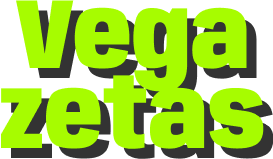

<p align="center">
  
</p>

<h1 align="center">Vegazetas</h1>

<p align="center">Español · <a href="./README-EN.md">English</a></p>

<p align="center">
  <strong>Una forma colorida de crear, organizar y compartir recetas veganas.</strong>
  <br>
  De Figma al despliegue, sin sufrimiento animal.
</p>

<p align="center">
  <a href="./doc/HISTORIAL-VERSIONES.md"></a>
</p>

<p align="center">
  <a href="https://vegazetas.netlify.app/">Explorar Vegazetas</a> 👀
  <br>
  <a href="https://www.figma.com/proto/wJ7OQyaNcJneXTPpf4jx6X/Vegazetas?node-id=149-214&t=m7ZNRd48c95egXOo-1&scaling=scale-down&content-scaling=fixed&page-id=149%3A212&starting-point-node-id=149%3A214">Prototipo en Figma</a>
</p>

<p align="center">
  <a href="https://github.com/Yevestevez">GitHub</a> ·
  <a href="https://www.linkedin.com/in/edu-yeves/">LinkedIn</a>
</p>

<p align="center">
  <strong>Vista previa pendiente</strong>
  <br>
  <sub>Guarda la captura en <code>doc/images/vegazetas-preview.png</code> y sustituye este recuadro por la imagen.</sub>
</p>

<!-- Cuando la imagen esté lista, sustituye el párrafo anterior por:
<p align="center">
  
</p>
-->

---

<p align="center"><strong>Frontend:</strong></p>
<p align="center">
  <a href="https://www.npmjs.com/package/vite"></a>
  <a href="https://react.dev/"></a>
  <a href="https://www.typescriptlang.org/"></a>
  <a href="https://tailwindcss.com/"></a>
</p>

<p align="center"><strong>Backend:</strong></p>
<p align="center">
  <a href="https://nodejs.org/"></a>
  <a href="https://expressjs.com/"></a>
  <a href="https://www.mongodb.com/"></a>
  <a href="https://zod.dev/"></a>
</p>

<p align="center"><strong>Testing:</strong></p>
<p align="center">
  <a href="https://vitest.dev/"></a>
  <a href="https://playwright.dev/"></a>
</p>

## Sobre el proyecto

Vegazetas es una aplicación web full-stack para guardar recetas veganas propias y descubrir las que publica la comunidad. La experiencia gira en torno a una interfaz expresiva y alegre, pensada para que crear y consultar recetas resulte sencillo.

Es un proyecto concebido y desarrollado de principio a fin por mí: desde el diseño UX/UI en Figma hasta la aplicación de una sola página, la API REST, la base de datos y el despliegue en la nube. La refactorización a TypeScript y las mejoras de esta versión se han realizado con asistencia de IA —agentes, skills y MCPs—, con **GitHub Copilot** y **Junie** (JetBrains) como herramientas principales y revisión humana en cada cambio.

## Funcionalidades

- Registro, inicio y cierre de sesión, y recuperación de contraseña.
- Creación, edición y eliminación de recetas.
- Recetas veganas con descripción, tiempo, dificultad, etiquetas, imágenes, ingredientes y pasos.
- Edición y reordenación de los pasos de preparación.
- Publicación de recetas para que otras personas puedan descubrirlas.
- Secciones para consultar las recetas propias, explorar recetas publicadas y guardar favoritas.

## Arquitectura

El proyecto sigue una arquitectura modular con paquetes separados y código compartido tipado:

- **Frontend:** React 19 con React Router 7, Vite 8, Tailwind CSS y TypeScript.
- **Backend:** API REST con Express 5.3, TypeScript, Mongoose y MongoDB.
- **Compartido:** paquete `com/` con validación Zod 4 y clases de error, consumido por ambos paquetes.
- **Seguridad:** Helmet, rate limiting, CORS configurado, protección contra JWT Algorithm Confusion.
- **Pruebas:** Vitest para lógica e integración (424 pruebas) y Playwright para navegador (68 pruebas); comandos en [api](./api/README.md#tests) y [app](./app/README.md#browser-tests).

Los detalles están en el [estado actual](./doc/ESTADO-ACTUAL.md) y la [estructura del proyecto](./doc/ESTRUCTURA-PROYECTO.md).

## Organización

- [`app/`](./app/): interfaz React; incluye su [README](./app/README.md).
- [`api/`](./api/): API Express y acceso a MongoDB; incluye su [README](./api/README.md).
- [`com/`](./com/): validaciones y errores compartidos.
- [`doc/`](./doc/): documentación técnica e imágenes.

## Puesta en marcha

Necesitas Node.js 26 LTS, npm y una instancia de MongoDB.
`.node-version` indica `26.13.1`. La aplicación y la API se ejecutan por
separado.

1. Configura las variables de entorno:
   - En `api/.env`, define `MONGO_URL`, `PORT` y `JWT_SECRET`. Para recuperación de contraseña, configura también `FRONTEND_URL`, `MAIL_FROM` y `NODE_ENV=development` en desarrollo; en producción se necesita `RESEND_API_KEY`.
   - En `app/.env`, define `VITE_API_URL` con la URL de la API.
2. Instala las dependencias compartidas desde la raíz:

   ```bash
   cd com
   npm ci
   ```

3. Instala y ejecuta la API en una terminal:

   ```bash
   cd api
   npm install
   npm start
   ```

4. Instala y ejecuta la aplicación en otra terminal:

   ```bash
   cd app
   npm install
   npm run dev
   ```

### Pruebas y calidad

La API cuenta con pruebas de lógica e integración con Vitest. Desde `api/`, ejecútalas con:

```bash
npm test
```

Antes de ejecutarlas, configura `SPEC_MONGO_URL` con una base de MongoDB **aislada y desechable**: las pruebas borran usuarios y recetas. Consulta las [instrucciones de pruebas de la API](./api/README.md#tests).

Desde `app/`, puedes comprobar el lint y generar la compilación de producción:

```bash
npm run lint
npm run build
```

Las pruebas de navegador con Playwright se ejecutan localmente con una base
de pruebas distinta. Consulta los [preparativos y comandos](./app/README.md#browser-tests).

Para el inventario técnico, variables y limitaciones conocidas, consulta el [estado actual](./doc/ESTADO-ACTUAL.md). La evolución prevista está en el [plan de refactorización](./doc/PLAN-REFACTORIZACION.md).

## Despliegue

La aplicación está desplegada en la nube:

- **Frontend:** [vegazetas.netlify.app](https://vegazetas.netlify.app) (Netlify)
- **Backend:** [vegazetas.onrender.com](https://vegazetas.onrender.com) (Render)
- **Base de datos:** MongoDB Atlas

Consulta la [guía de despliegue](./doc/DEPLOYMENT.md) para la configuración y los problemas conocidos.

## Evolución del proyecto

La refactorización a TypeScript está completa. Los detalles están en el [plan de refactorización](./doc/PLAN-REFACTORIZACION.md).

Se está integrando un asistente de IA para la creación de recetas: a partir de una descripción informal, el sistema genera estructura, ingredientes y pasos de preparación, acelerando el flujo de entrada de datos.

Próximas mejoras a considerar: filtros, recetas compartidas, listas, gestión del perfil, planificación de menús, modo cocina y ajustes de visualización. Son ideas, no funcionalidades comprometidas.

## Diseño

Consulta el [prototipo de Vegazetas en Figma](https://www.figma.com/proto/wJ7OQyaNcJneXTPpf4jx6X/Vegazetas?node-id=149-214&t=m7ZNRd48c95egXOo-1&scaling=scale-down&content-scaling=fixed&page-id=149%3A212&starting-point-node-id=149%3A214).

## Créditos

- Diseño UX/UI y desarrollo: [Yevestevez](https://github.com/Yevestevez).
- Refactorización y mejoras de esta versión asistidas por IA con **GitHub Copilot** y **Junie** (JetBrains).
- Prototipo diseñado en [Figma](https://www.figma.com/proto/wJ7OQyaNcJneXTPpf4jx6X/Vegazetas?node-id=149-214&t=m7ZNRd48c95egXOo-1&scaling=scale-down&content-scaling=fixed&page-id=149%3A212&starting-point-node-id=149%3A214).

## Licencia

Distribuido bajo la licencia [MIT](./LICENSE).
