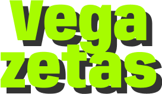

<p align="center">
  
</p>

<h1 align="center">Vegazetas</h1>

<p align="center">Español · <a href="./README-EN.md">English</a></p>

<p align="center">
  <strong>Una forma colorida de crear, organizar y compartir recetas veganas.</strong>
  <br>
  Diseñado y desarrollado artesanalmente de principio a fin: desde Figma hasta el despliegue.
</p>

<p align="center">
  <a href="https://vegazetas.netlify.app/">Explorar Vegazetas</a>
</p>

<p align="center">
  <a href="https://github.com/Yevestevez">GitHub</a> ·
  <a href="https://www.linkedin.com/in/edu-yeves/">LinkedIn</a>
</p>

---

**Versión de referencia: v1.0.0**, correspondiente al estado actual de producción. Todavía no se ha creado una etiqueta ni una publicación.

## Sobre el proyecto

Vegazetas es una aplicación web para guardar recetas veganas propias y descubrir las que publica la comunidad. La experiencia gira en torno a una interfaz expresiva y alegre, pensada para que crear y consultar recetas resulte sencillo.

Es un proyecto full-stack diseñado y desarrollado íntegramente por mí: desde el diseño UX/UI en Figma y la aplicación de una sola página hasta la API REST, la base de datos y el despliegue. El proyecto también incluye pruebas automatizadas para la lógica de negocio de la API.

## Funcionalidades

- Registro, inicio y cierre de sesión, y recuperación de contraseña.
- Creación, edición y eliminación de recetas.
- Recetas veganas con descripción, tiempo, dificultad, etiquetas, imágenes, ingredientes y pasos.
- Edición y reordenación de los pasos de preparación.
- Publicación de recetas para que otras personas puedan descubrirlas.
- Secciones para consultar las recetas propias, explorar recetas publicadas y guardar favoritas.

## Tecnologías

| Área | Tecnologías |
| --- | --- |
| Frontend | React, React Router, Tailwind CSS, Vite |
| Backend | Node.js, Express |
| Datos | MongoDB, Mongoose |
| Calidad | Mocha, Chai, c8, ESLint |

## Organización y datos

- [`app/`](./app/): interfaz React; incluye su [README](./app/README.md).
- [`api/`](./api/): API Express y acceso a MongoDB; incluye su [README](./api/README.md).
- [`com/`](./com/): validaciones y errores compartidos.
- [`doc/`](./doc/): documentación técnica e imágenes.

El modelo incluye usuarios con favoritos y recetas con autor, imágenes, descripción, tiempo, dificultad, etiquetas, ingredientes, pasos y estado de publicación. Ingredientes y pasos se almacenan dentro de la receta. Los detalles están en el [estado actual](./doc/ESTADO-ACTUAL.md).

## Puesta en marcha

Necesitas Node.js, npm y una instancia de MongoDB. La aplicación y la API se ejecutan por separado.

1. Configura las variables de entorno:
   - En `api/.env`, define `MONGO_URL`, `PORT` y `JWT_SECRET`. Para recuperación de contraseña, configura también `FRONTEND_URL`, `MAIL_FROM` y `NODE_ENV=development` en desarrollo; en producción se necesita `RESEND_API_KEY`.
   - En `app/.env`, define `VITE_API_URL` con la URL de la API.
2. Instala y ejecuta la API en una terminal:

   ```bash
   cd api
   npm install
   npm start
   ```

3. Instala y ejecuta la aplicación en otra terminal:

   ```bash
   cd app
   npm install
   npm run dev
   ```

### Pruebas y calidad

La API cuenta con pruebas automatizadas para sus lógicas de negocio, escritas con Mocha y Chai. Desde `api/`, ejecútalas con:

```bash
npm test
```

Antes de ejecutarlas, configura `SPEC_MONGO_URL` con una base de MongoDB **aislada y desechable**: las pruebas borran usuarios y recetas.

Desde `app/`, puedes comprobar el lint y generar la compilación de producción:

```bash
npm run lint
npm run build
```

Para el inventario técnico, variables y limitaciones conocidas, consulta el [estado actual](./doc/ESTADO-ACTUAL.md). La evolución prevista está en el [plan de refactorización](./doc/PLAN-REFACTORIZACION.md).

La [captura histórica de cobertura](./doc/images/vegazetas-test-coverage-082025.jpg) es de agosto de 2025 y no representa necesariamente la cobertura actual.

## Evolución del proyecto

El proyecto está preparando una base más mantenible, segura y accesible para seguir creciendo. Los detalles están en el [plan de refactorización](./doc/PLAN-REFACTORIZACION.md).

Una vez consolidada esa base, se podrán valorar filtros, recetas compartidas, listas, gestión del perfil, planificación de menús, modo cocina y ajustes de visualización. Son ideas, no funcionalidades comprometidas.

## Diseño

Consulta el [prototipo de Vegazetas en Figma](https://www.figma.com/proto/wJ7OQyaNcJneXTPpf4jx6X/Vegazetas?node-id=149-214&t=m7ZNRd48c95egXOo-1&scaling=scale-down&content-scaling=fixed&page-id=149%3A212&starting-point-node-id=149%3A214).
