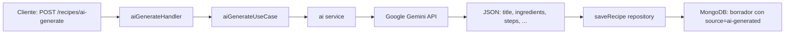

# Plan de integración de IA con Gemini API

Este documento describe la integración de Google Gemini API para generar recetas de forma automática en Vegazetas.
Está diseñado para uso personal (una sola persona), sin capas de pago ni autenticación premium.

Los campos necesarios ya están preparados en `models.v2.ts`: `source`, `sourceUrl`, `aiNotes`, `nutrition`.

---

## Provider: Google Gemini API

| Aspecto | Detalle |
|---------|--------|
| Modelos | Gemini 2.0 Flash, Gemini 2.5 Flash, Gemini 2.5 Pro |
| Límites gratuitos | 1,500 req/día (Flash), 100 req/día (Pro) |
| Tarjeta de crédito | No requerida |
| Contexto | Hasta 2M tokens |
| Multimodal | Texto + imagen + URL |
| API | REST directa, compatible con SDK OpenAI |

**Ventajas para Vegazetas:**
- Puedes pasarle una URL de receta y Gemini la analiza para extraer ingredientes, pasos, etc.
- 1,500 recetas/día es más que suficiente para una app en crecimiento
- No necesitas tarjeta de crédito ni configuración de facturación
- Compatible con el SDK de OpenAI (`openai` npm) configurando `baseURL`

**Si se agotan las llamadas gratuitas:** La API devuelve error 429. No se genera ningún cargo. La app muestra un mensaje al usuario.
---

## Enfoque

- **API compatible con OpenAI:** Usar el SDK `openai` de npm con `baseURL` apuntando a Gemini. Esto evita dependencias adicionales y es fácil de cambiar de provider en el futuro.
- **Endpoint nuevo:** `POST /recipes/ai-generate` que recibe texto o URL del usuario, llama a Gemini, y crea un borrador de receta (`published: false`, `source: ``ai-generated``).
- **Sin frontend todavía:** El usuario solo quiere la parte de backend por ahora. El frontend se añade después.

---

## Arquitectura



---

## Archivos a crear/modificar

| Archivo | Acción |
|---------|--------|
| `api/services/ai.ts` | **Nuevo.** Servicio que llama a Gemini con un prompt template y devuelve JSON estructurado. |
| `api/modules/recipes/aiGenerate/aiGenerate.ts` | **Nuevo.** Caso de uso: valida entrada, llama a `ai.ts`, parsea respuesta, crea receta. |
| `api/modules/recipes/aiGenerate/aiGenerateHandler.ts` | **Nuevo.** Handler Express que extrae `text` y `sourceUrl` del body. |
| `api/modules/recipes/aiGenerate/recipeRepository.ts` | **Nuevo.** Reutiliza `saveRecipe` de `createRecipe/recipeRepository.ts` (exportarlo compartido). |
| `api/modules/recipes/aiGenerate/composition.ts` | **Nuevo.** Enlaza handler → use case → repository. |
| `api/routes/recipes/index.ts` | **Modificar.** Añadir ruta `POST /recipes/ai-generate`. |
| `api/package.json` | **Modificar.** Añadir dependencia `openai`. |
| `.env` del backend | **Modificar.** Añadir `GEMINI_API_KEY`. |
---

## Prompt Template

El servicio `ai.ts` enviará un prompt del tipo:

```
Eres un asistente que genera recetas vegetarianas. A partir del texto o URL proporcionado,
devuelve ÚNICAMENTE un JSON con esta estructura:
{
  "title": "string",
  "description": "string",
  "category": "entrante|principal|postre|sopa|ensalada|snack|bebida|otro",
  "servings": number,
  "time": number (minutos),
  "difficulty": "easy|medium|difficult",
  "tags": ["string"],
  "ingredients": [{"name": "string", "quantity": number, "unit": "string", "annotation": "string", "main": boolean}],
  "steps": [{"text": "string", "note": "string", "order": number}],
  "nutrition": {"calories": number, "protein": number, "carbs": number, "fat": number},
  "aiNotes": "string (notas opcionales de la IA)"
}

Texto o URL del usuario: {input}
```

---

## Validaciones

- `text` (string, requerido, máximo 4000 caracteres): descripción o ingredientes del usuario.
- `sourceUrl` (string, opcional, URL válida, máximo 2000 caracteres): URL de receta a importar.
- Al menos uno de `text` o `sourceUrl` debe estar presente.

---

## Errores

- **Rate limit:** Gemini devuelve 429 → backend devuelve 503 con mensaje "servicio IA temporalmente no disponible".
- **Timeout:** 30 segundos máximo por llamada a Gemini.
- **Parse error:** Si la respuesta no es JSON válido, devuelve 500 con "error al procesar la respuesta de IA".
- **API key faltante:** 500 con "configuración de IA no disponible".

---

## Notas

- La receta se guarda como borrador (`published: false`) para que el usuario la revise.
- `source` se establece a ``ai-generated`` o ``url-import`` según si el usuario pasó URL.
- `author` se obtiene de la sesión del usuario (como en `createRecipe`).
- No se requiere autenticación premium ni capas de pago. Es para uso personal.
- El SDK `openai` funciona con Gemini configurando `baseURL: ``https://generativelanguage.googleapis.com/v1beta/openai```.